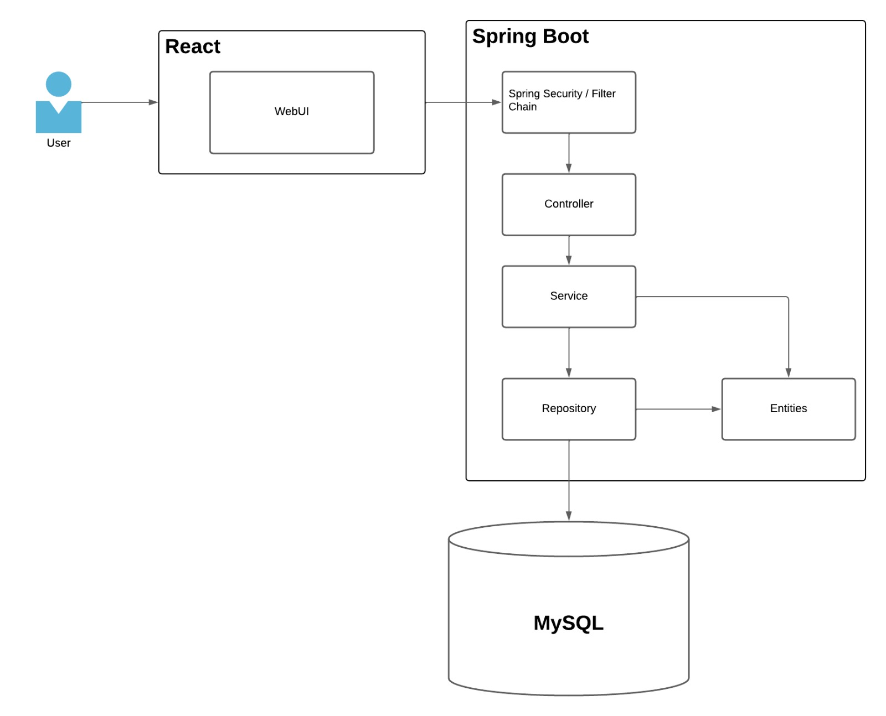

# 📚 Study Together

Applicazione web per la creazione e gestione di gruppi di studio.

---

## 🧭 Panoramica

L'obiettivo del progetto è facilitare la collaborazione tra studenti, automatizzando la formazione dei gruppi di studio in base a criteri come interessi, disponibilità e compatibilità.

---

## 🏗️ Architettura e Tecnologie

Il progetto segue un'architettura client-server disaccoppiata.

- **Backend**: sviluppato con Spring Boot  
  Gestisce:
  - logica di business
  - accesso al database MySQL

- **Frontend**: sviluppato con React  
  Comunica tramite API REST asincrone.

- **Sicurezza**: implementata con Spring Security
  Include:
  - autenticazione utenti
  - hashing password
  - gestione token (sessioni)
  - autorizzazione endpoint
  
---

## 🔄 Architettura Logica

L’applicazione è suddivisa in tre livelli principali:

- **Presentation Layer** → Frontend React  
- **Business Logic Layer** → Backend Spring Boot  
- **Data Access Layer** → MySQL  



---

## ⚙️ Tecnologie Utilizzate

### Backend
- Java 21 (Eclipse Temurin)
- Maven 3.9.6
- Spring Boot 4.0.5
- Spring Security
- Spring Data JPA (Hibernate)

### Frontend
- React 19.2.4
- Vite 8.0.4
- Node.js 22

### Database
- MySQL 8.x

### DevOps
- Docker
- CI/CD pipeline

---

## ⚙️ Build & Dipendenze (Maven POM)

Il backend è gestito tramite Maven e configurato nel file `pom.xml`.

---

### 📦 Dipendenze principali

Il progetto utilizza le seguenti tecnologie:

- Spring Boot Web → API REST
- Spring Data JPA → accesso al database
- Spring Security → autenticazione e autorizzazione
- Spring Mail → invio email
- MySQL Driver → connessione al database
- Spring Boot DevTools → hot reload in sviluppo

---

### 🧪 Testing

Il progetto include una suite di test strutturata in più livelli.
- H2 → test DB
- Cucumber → 7.34.2
- Testcontainers → 1.21.4

#### 🔹 Unit Test
- Gestiti da **Maven Surefire Plugin**
- Eseguono tutti i test `*Test.java`
- Escludono:
  - `*IT.java` (integration test)
  - `*CucumberTest.java` (BDD test)

---

#### 🔹 Integration Test
- Gestiti da **Maven Failsafe Plugin**
- Eseguono:
  - `*IT.java`
  - `*CucumberTest.java`
- Utilizzati per testare:
  - API complete
  - interazione con database
  - flussi end-to-end

---

#### 🔹 Cucumber (BDD)
- Librerie utilizzate:
  - cucumber-java
  - cucumber-spring
  - cucumber-junit-platform-engine
- Permettono di scrivere test basati su scenari (Given / When / Then)

---


## 🚀 Avvio del Progetto

### ▶️ Metodo consigliato: Docker

Prerequisiti:
- Docker
- Docker Compose

Avvio:

```bash
docker-compose up --build
